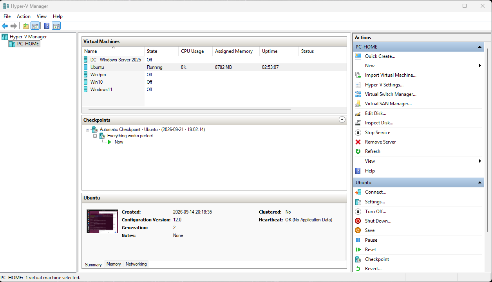
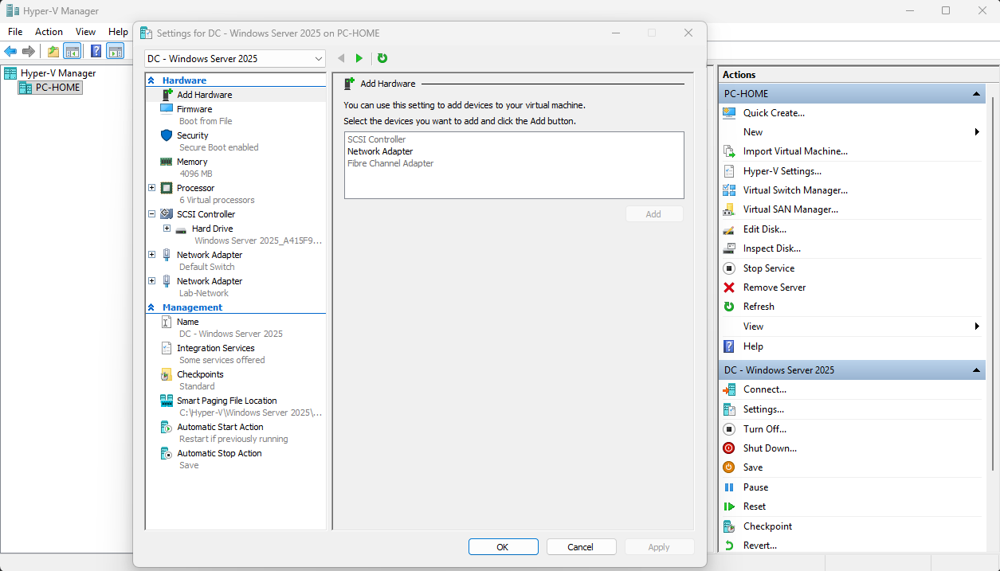
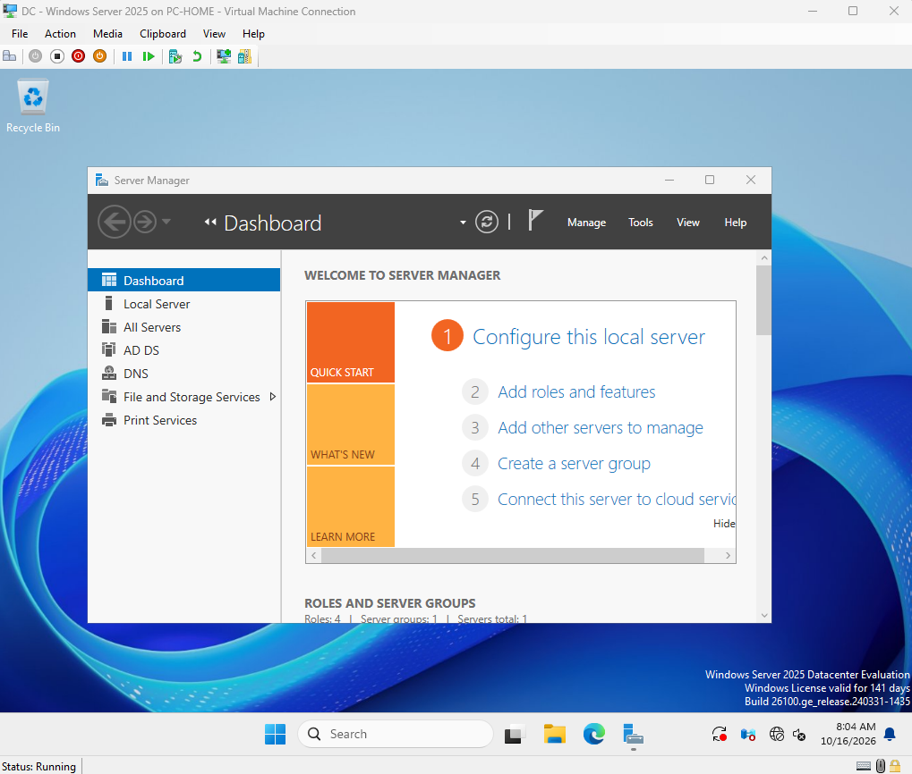
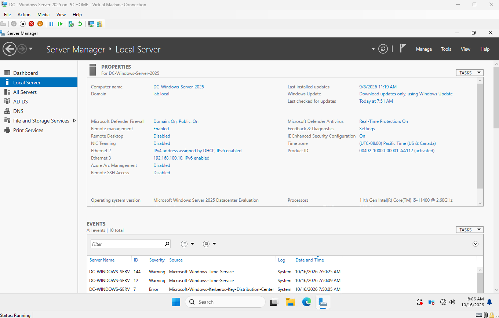
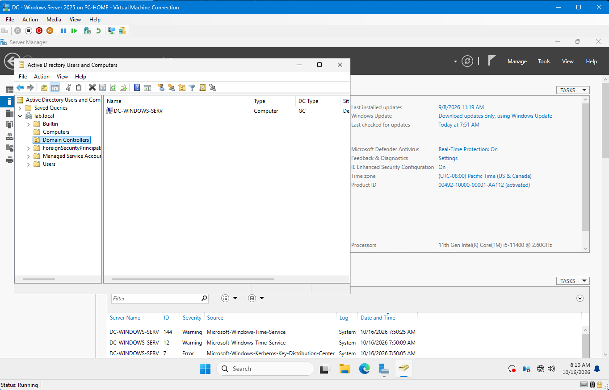
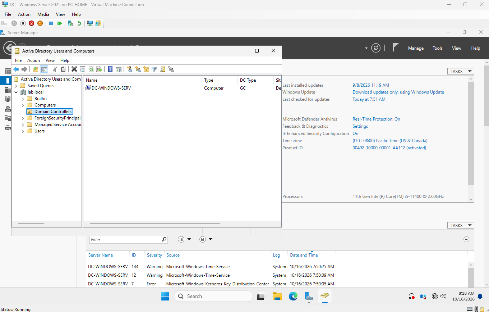
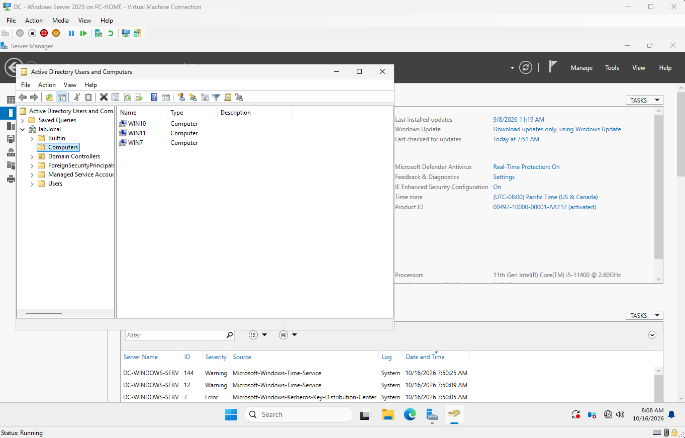
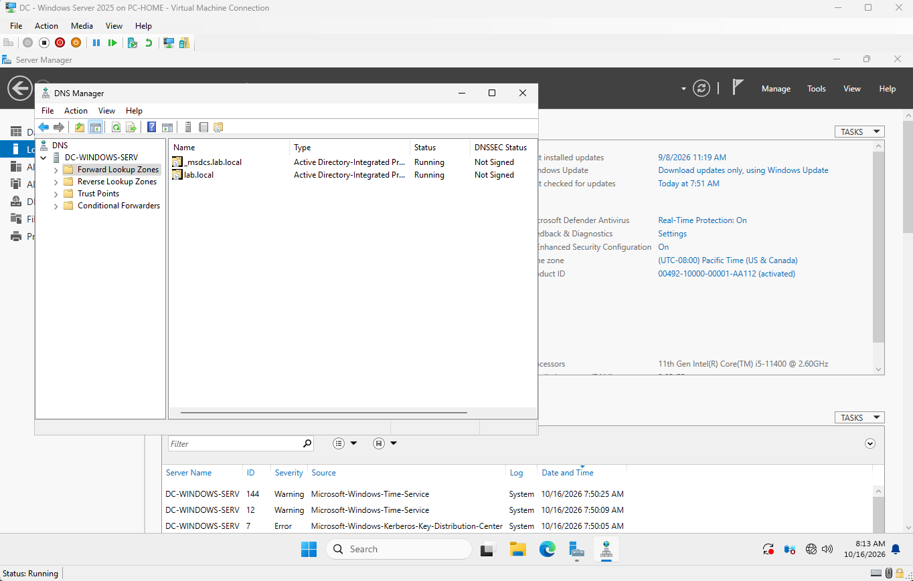
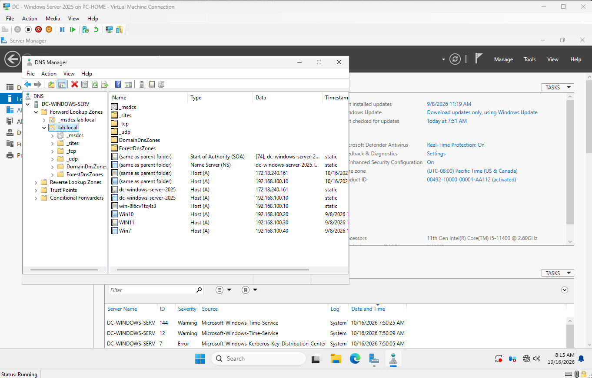

# Windows Server 2025 — Lab Evidence

This directory documents my practical Windows Server 2025 and Hyper-V lab. The screenshots show the virtual machine configuration, server administration, Active Directory, DNS, and virtual networking.

## 1. Hyper-V Virtual Machine Overview

The Hyper-V environment contains Windows Server 2025 and Windows client virtual machines.

## 2. Windows Server Virtual Machine Settings

Virtual hardware configuration for the Windows Server 2025 domain controller, including memory, processors, firmware, storage, and network adapters.

## 3. Domain Controller Network Adapter — Default Switch

The Hyper-V network adapter configuration for the `Default Switch`.

## 4. Domain Controller Network Adapter — Lab-Network

The Hyper-V network adapter configuration for `Lab-Network`.

## 5. Server Manager

The Server Manager dashboard provides access to Windows Server management tools and installed server roles.

## 6. Local Server Configuration

Server identity, domain membership, network interfaces, firewall status, and other local server properties.

## 7. Active Directory Domain Controllers

The Domain Controllers container in Active Directory Users and Computers, showing the domain controller registered in the `lab.local` domain.

## 8. Active Directory Domain Controllers — Additional View

An additional screenshot documenting the domain controller object in Active Directory.

## 9. Active Directory Computer Accounts

The Computers container showing the `WIN7`, `WIN10`, and `WIN11` computer objects registered in Active Directory.

## 10. DNS Forward Lookup Zones

DNS Manager showing the `lab.local` and `_msdcs.lab.local` forward lookup zones.

## 11. DNS Records in lab.local

DNS records displayed in the `lab.local` forward lookup zone, including host records for the server and Windows clients.

## Summary

The screenshots document:

- Hyper-V virtual machine configuration
- Windows Server 2025 administration
- Hyper-V virtual switches and network adapters
- Active Directory domain controller and computer objects
- DNS zones and host records

These screenshots provide evidence of the visible configuration. They do not independently establish that every service or network connection has been tested successfully.
